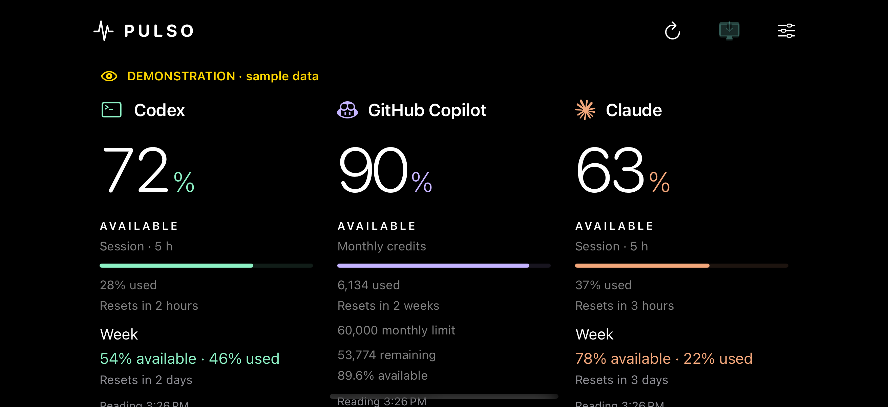
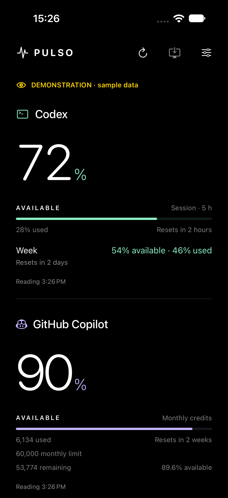

<div align="center">

# Pulso

### Your AI limits. One glance.

A native iPhone dashboard for **Codex, Claude, and GitHub Copilot**.
Keep your quotas close: on your desk, Home Screen, Lock Screen, or Apple Watch.

**SwiftUI** &nbsp; / &nbsp; **iOS 17+** &nbsp; / &nbsp; **watchOS 10+** &nbsp; / &nbsp; **English & Spanish**

[Website](https://olivathedev.com/) &nbsp; / &nbsp; [Buy me a coffee](https://ko-fi.com/olivathedev) &nbsp; / &nbsp; [License](LICENSE)



</div>

## Less guessing. More building.

Pulso puts the usage information that matters in one quiet, glanceable place:
remaining quota, used quota, renewal times, and the freshness of the last reading.
No fake activity indicators. No pretend real-time usage.

- **Three providers, one dashboard.** Codex session and weekly windows, Claude usage windows, and GitHub Copilot allowance information where the connected account exposes it.
- **Your numbers, your view.** Switch between remaining and used quota, choose visible providers, and use portrait or a three-column landscape layout.
- **Made for your desk.** Dark OLED-friendly styling, desk mode, a red night tone, and StandBy-compatible widgets.
- **Interactive widgets.** Refresh an individual provider or the summary directly in the widget without opening Pulso. iOS may require unlocking before interaction.
- **Live Activities and Apple Watch.** Keep supported quota information nearby without returning to the dashboard.
- **Useful reminders.** Optional local reset alerts and native renewal countdowns, including days and hours for long intervals.
- **English and Spanish.** Follows the device or per-app language.

<div align="center">

</div>

Screenshots are real iOS Simulator captures with synthetic development data.
Sample accounts and demo controls are compiled only into **Debug** builds.
**Release builds contain no demo UI or sample-data activation.**

## Connections and privacy

| Provider | Connection |
|---|---|
| Codex | Native OAuth with the system browser; usage is retrieved with the authorized account session. |
| Claude | Sign-in inside the app; the authenticated session is reused for native quota requests. Some login providers may restrict embedded sign-in. |
| GitHub Copilot | GitHub authentication/token connection; available billing and allowance fields depend on the account and organization. |

Pulso does not require a separate Pulso backend. Provider requests go directly
to the relevant services. Credentials are stored in the device Keychain, not
in plain-text preferences. A restricted shared Keychain group lets the iPhone
app and its widget extension refresh independently after the first unlock.
The Apple Watch receives quota state, not provider credentials.

**Important limitations**

Automatic widget, StandBy, and background updates are scheduled by iOS.
A requested refresh time is not a guaranteed polling interval. The manual
widget button requests a new reading; a live countdown alone does not mean
new usage data has arrived.

Some provider integrations use undocumented service endpoints and authenticated
web sessions. They can change, become unavailable, or be restricted by provider
policies. Account plans and organization permissions affect which values are
available. Use your own accounts and comply with each provider's terms.
Pulso is an independent project, not an official OpenAI, Anthropic, or GitHub app.

## Build your own

Requirements: macOS, Xcode with iOS and watchOS SDKs, and Python 3 for project
generation. The project is tested with Xcode 27.2; deployment targets are
iOS 17 and watchOS 10.

```bash
git clone https://github.com/jesus0m/Pulso.git
cd Pulso
python3 scripts/generate_project.py
open Pulso.xcodeproj
```

In Xcode, choose your own signing team and configure unique bundle identifiers,
App Groups, and Keychain Sharing consistently across the app, widgets, and watch
targets. Update the corresponding identifiers in the source and entitlements
if you change them. Select the **Pulso** scheme and run on an iPhone simulator
or your development device.

There are no third-party package dependencies. The Xcode project is generated
by [`scripts/generate_project.py`](scripts/generate_project.py); update the
generator when changing target membership or build configuration.

### Development and tests

Debug builds include sample data for UI development and screenshots.
Launch a Debug simulator build with `--demo --reset-preferences`, or use the
development controls in Settings. Do not use reset arguments on a device with
accounts you want to keep. Release builds ignore both development arguments.

```bash
# Replace the simulator name with one installed on your Mac.
xcodebuild -project Pulso.xcodeproj -scheme Pulso \
  -destination 'platform=iOS Simulator,name=iPhone 18 Pro' \
  -only-testing:PulsoTests test
```

Keep normal simulator signing enabled: App Group and shared Keychain tests
depend on simulated entitlements. UI tests that launch demo data are intended
for simulators, not a personal device with real accounts.

## Support the project

If Pulso makes your workday a little calmer, you can support its development:

**[Buy me a coffee on Ko-fi](https://ko-fi.com/olivathedev)**

Created by **Jesus Oliva Morales (olivathedev)**.
[olivathedev.com](https://olivathedev.com/)

## License

Copyright (c) 2026 Jesus Oliva Morales (olivathedev).

Pulso is **source-available for personal, noncommercial use** under the custom
[Pulso Personal Noncommercial License](LICENSE). Commercial use, sale, and
commercial redistribution require the author's prior written permission.
This is **not** MIT-licensed or an OSI open-source project.

Third-party brands and logos belong to their respective owners. Publishing
this repository does not imply provider endorsement or App Store approval.
